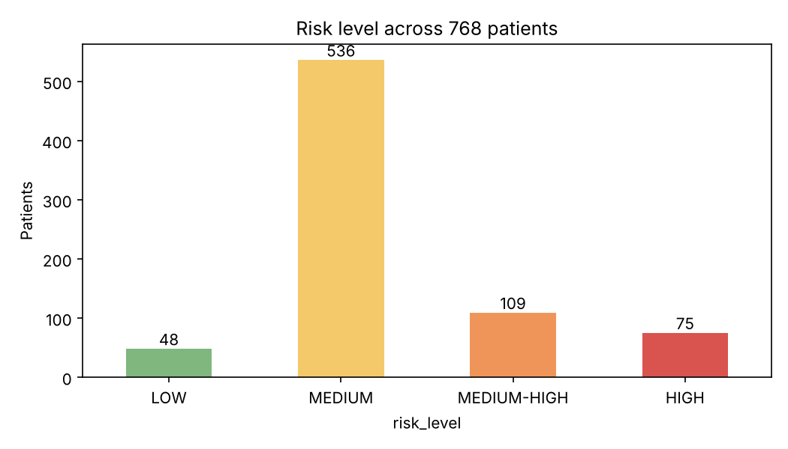
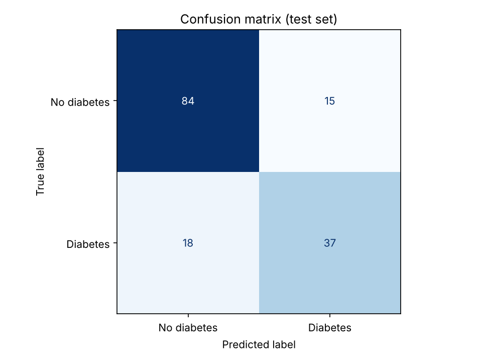
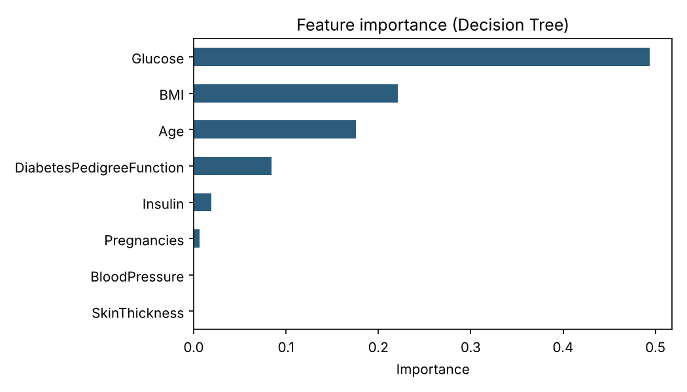

# Diabetes Decision Support System (Search + Rules + Machine Learning)

A small AI project that helps spot patients at risk of diabetes, using three different AI methods on the same data.

Each method answers a different question:

| Method | Question it answers | Notebook |
|---|---|---|
| Breadth-First Search (BFS) | **Which** patients should we check first? | [01_bfs_triage](notebooks/01_bfs_triage.ipynb) |
| Rule-based system | **Why** is this patient high risk? | [02_rule_based_system](notebooks/02_rule_based_system.ipynb) |
| Decision Tree | **Is** this patient likely to have diabetes? | [03_decision_tree](notebooks/03_decision_tree.ipynb) |

## Data

- **Pima Indians Diabetes dataset**: 768 patients, 8 clinical features and an `Outcome` column (1 = diabetes).
- Source: [UCI / Kaggle](https://www.kaggle.com/datasets/uciml/pima-indians-diabetes-database)
- Some values were recorded as `0` where that is impossible (for example BMI or blood pressure). In [00_data_cleaning](notebooks/00_data_cleaning.ipynb) I replace those zeros with the median of each column.

## Results

### 1. BFS triage
BFS checks patients one by one with a FIFO queue and flags anyone who meets at least one of six clinical conditions (glucose, age, BMI, blood pressure, insulin, family history). It found **20 high-risk patients after scanning only 26 records**.

### 2. Rule-based advisor
Six IF-THEN rules give every patient a risk level and show which rules fired, so the decision is easy to explain.

| Risk level | Patients | % |
|---|---|---|
| Medium | 536 | 69.8 |
| Medium-High | 109 | 14.2 |
| High | 75 | 9.8 |
| Low | 48 | 6.2 |



### 3. Decision Tree
- **Accuracy: 78.6%** on the test set (154 patients)
- **Recall for diabetes: 67%**. The model missed 18 diabetic patients, and in health care these false negatives are the most serious errors.
- With a stratified split, accuracy was 76.6% and recall went up to 74%.

<p>
  
  
</p>

**Glucose, BMI and Age** were the most important features. These are the same three that matter most in the rule-based system, so the methods agree with each other.

## What I learned

- Accuracy is not enough in health care. Recall (not missing sick patients) matters more.
- Explainable methods like rules and decision trees are easier to trust in a clinical setting.
- BFS is simple and repeatable, but it cannot rank patients by how urgent they are. A heuristic search would be needed for that.
- This data comes from women of Pima Indian background in the US. Before using a system like this in New Zealand, it would need to be tested on New Zealand data, especially for Māori and Pacific communities.

## How to run it

```bash
pip install -r requirements.txt
jupyter notebook
```

Then run the notebooks in order, starting with `00_data_cleaning`.

## Project structure

```
diabetes-decision-support/
├── data/
│   ├── diabetes.csv            # original dataset
│   └── diabetes_cleaned.csv    # after replacing impossible zeros
├── notebooks/
│   ├── 00_data_cleaning.ipynb
│   ├── 01_bfs_triage.ipynb
│   ├── 02_rule_based_system.ipynb
│   └── 03_decision_tree.ipynb
├── images/
└── requirements.txt
```

## Author

**Aliaa Farag**, early childhood teacher moving into data analytics, Auckland, New Zealand
[LinkedIn](https://www.linkedin.com/in/aliaafarag)

*This is a learning project. It is not a medical tool and should not be used for real diagnosis.*
